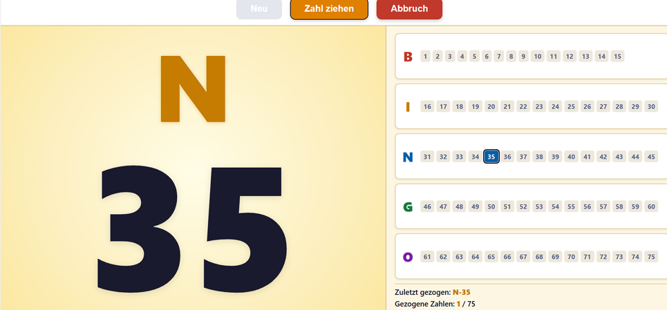

# bingogame

Diese Anwendung dient dazu, bei einer Bingo-Veranstaltung, insbesondere mit älteren  Menschen,
allen immer die aktuellen Zahlen anzuzeigen. So kann jeder, auch wenn er nicht mehr so gut sehen
 kann bzw. mal abgelenkt war, die Zahlen mitverfolgen, auch nachträglich.

 Die Anwendung ist einfach gehalten und ohne Erklärung zu verstehen.

 Viel Spaß, meine Senioren finden es gut.
